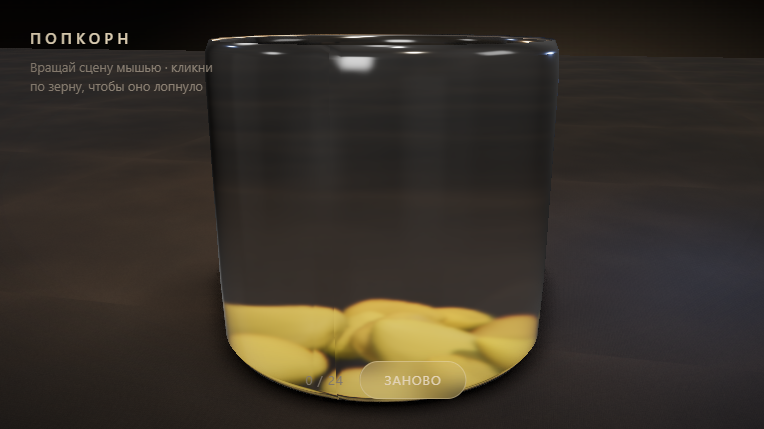
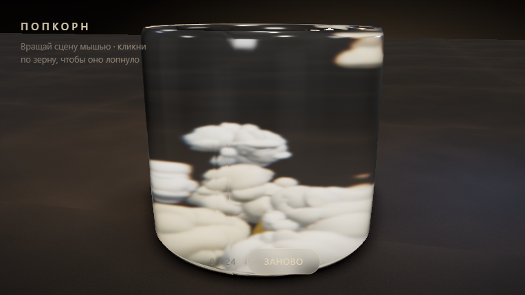

# Попкорн в стакане

Небольшая антистресс-игра: прозрачный стакан, на дне — кукурузные зёрна.
Стакан можно вращать в 3D, по зёрну можно кликнуть — оно лопается, резко
увеличивается в объёме и получает импульс: подлетает, бьётся о стенки или
вылетает из стакана.

| Старт | В процессе |
|---|---|
|  |  |

## Запуск

```bash
npm install
npm run dev          # http://127.0.0.1:5178
```

Сборка: `npm run build`, локальный предпросмотр сборки: `npm run preview`.

## Управление

| Действие | Что делает |
|---|---|
| ЛКМ + движение | вращение сцены (OrbitControls) |
| Клик по зерну | лопается |
| Колесо | приближение/отдаление |
| «Заново» | новая партия зёрен |

Клик отличается от вращения по смещению указателя (< 7 px) и времени (< 700 мс),
поэтому перетаскивание не лопает зёрна случайно.

## Стек

- **three.js** — рендер. `MeshPhysicalMaterial` с `transmission` для стекла,
  PMREM-окружение из `RoomEnvironment`, ACES tone mapping, PCF soft shadows.
- **Rapier** (`@dimforge/rapier3d-compat`) — физика. Шаг 1/60 с аккумулятором,
  CCD включён.
- **GTAOPass** — ambient occlusion: без него зёрна в куче выглядят как наклейки.
- **Vite** — дев-сервер.

## Как устроено

```
src/geometry.js   процедурная геометрия: зерно, попкорн, стакан
src/main.js       сцена, свет, материалы, физика, ввод, цикл
```

Геометрия целиком генерируется кодом, внешних ассетов нет.

**Зерно** — лат-профиль (заострённый низ, самое широкое место на 65% длины),
сплюснутый по Z, с вогнутой впадиной на лицевой стороне и шумовой
неоднородностью. Размер 0.2 условных единицы.

**Попкорн** — оболочка из 24–31 мелких вспученных долей радиусом 0.045–0.083,
посаженных на сферу радиуса ~0.09 так, чтобы каждая торчала наружу, плюс
7 крошек по краю. Каждая доля деформирована шумом: узкие гауссовы канавки
(`fold`) дают складки, анизотропное сжатие — плоские «лепестки».

**Стакан** — лат-профиль замкнутого контура (внешнее дно → стенка → кромка →
внутренняя стенка → внутреннее дно), поэтому у стекла реальная толщина.

**Коллайдеры стакана** — не triangle mesh, а кольцо из 40 тонких коробок
плюс цилиндр-дно: выпуклые коллайдеры в разы стабильнее для кучи мелких тел.
При 40 сегментах многоугольник неотличим от круглого стакана.

**Коллайдер попкорна** — выпуклая оболочка его собственной геометрии. Шар
не подходит: комок неровный, и шар либо парит над столом, либо тонет в нём.

## Что крутить для настройки

| Файл | Константа | Смысл |
|---|---|---|
| `main.js` | `KERNEL_COUNT` | сколько зёрен в партии |
| `main.js` | `GRAVITY` (в `new RAPIER.World`) | −6 даёт чуть замедленное, «антистрессовое» падение |
| `main.js` | `up` / `side` в `popKernel` | сила хлопка. `up` распределено как `1.5 + rand^1.6 * 4.6`: хвост распределения как раз и выкидывает часть попкорна за край |
| `main.js` | `setLinearDamping` / `setAngularDamping` | 0.28 / 2.2 — попкорн не укатывается далеко от стакана |
| `geometry.js` | `KERNEL_PROFILE`, `GLASS_PROFILE` | форма зерна и стакана |
| `geometry.js` | `foldFreq = 0.62 / radius` | частота складок. Ширина канавки ≈ `0.09 / foldFreq`, и она должна быть больше длины ребра сетки, иначе складка не проявится |
| `geometry.js` | `createPopcornGeometry` | количество и размер долей |

## Известные ограничения

- Формы процедурные, а не отсканированные: на крупном плане попкорн читается
  как стилизованный, а не фотореалистичный. Дальше двигаться нужно либо
  в сторону скульптинга в Blender, либо в сторону карт нормалей с
  UV-развёрткой.
- Стакан не отбрасывает настоящую тень (transmission-материал дал бы чёрное
  пятно вместо каустики) — вместо неё мягкое поддельное пятно.
- Звук синтезируется в WebAudio, внешних файлов нет; включается после первого
  клика из-за политики автовоспроизведения.

## Отладочный доступ

В консоли браузера доступен `window.__game`:

```js
__game.kernels                 // список зёрен: body, mesh, collider, popped
__game.popKernel(__game.kernels[0])
__game.resetGame()
__game.sim(120)                // только физика, без рендера
__game.tick(120)               // физика + рендер
```
